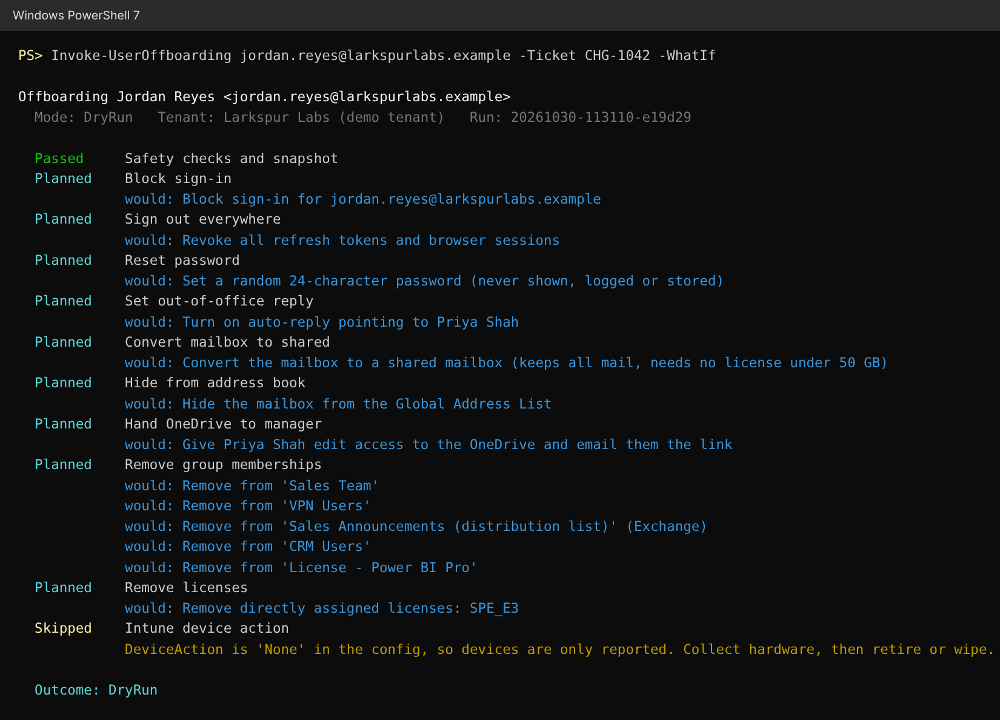
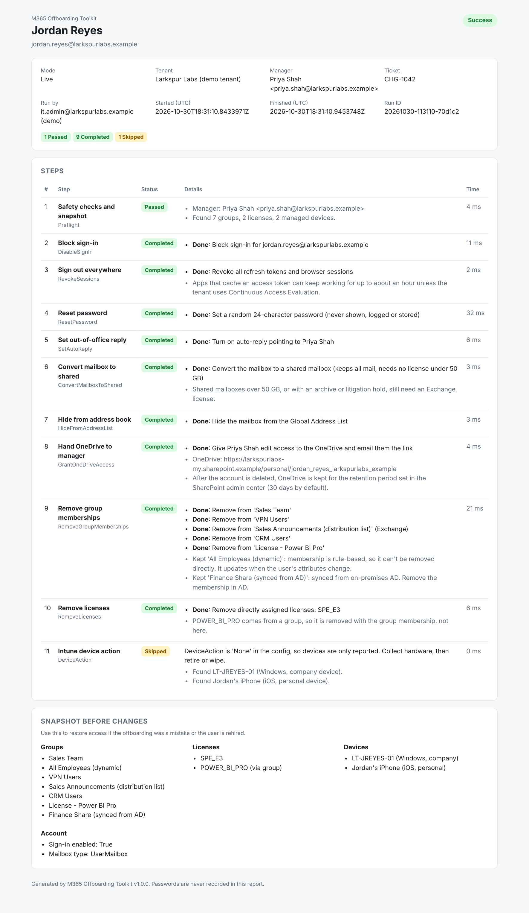
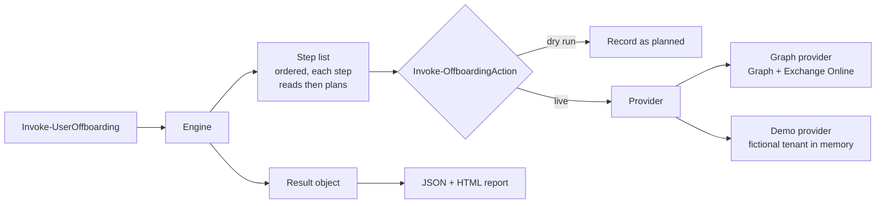

# M365 Offboarding Toolkit

[](../../actions/workflows/ci.yml)


A PowerShell module that offboards a Microsoft 365 user in one command, with a dry run first and an audit report at the end.

Offboarding by hand means clicking through Entra ID, Exchange, the Microsoft 365 admin center and Intune, usually from a checklist. Steps get missed, they get done in the wrong order (removing the license before converting the mailbox deletes the mailbox 30 days later), and afterwards nobody can prove exactly what was removed. This module does the whole sequence through Microsoft Graph and Exchange Online, refuses to touch accounts it shouldn't, and writes a report you can attach to the ticket.

**Try it without a Microsoft 365 tenant:** it ships with a fictional demo company, so `./examples/Start-Demo.ps1` runs the full flow on any machine with PowerShell 7.



## What it does

| # | Step | How |
|---|------|-----|
| 1 | Safety checks and snapshot | Refuses protected accounts, admins and AD-synced users. Records groups, licenses, devices and mailbox type before anything changes. |
| 2 | Block sign-in | Graph: `PATCH /users/{id}` `accountEnabled = false` |
| 3 | Sign out everywhere | Graph: `POST /users/{id}/revokeSignInSessions` |
| 4 | Reset password | Random 24-character password, never shown, logged or saved |
| 5 | Set out-of-office reply | Graph: mailbox settings, pointing senders to the manager |
| 6 | Convert mailbox to shared | Exchange Online: `Set-Mailbox -Type Shared` |
| 7 | Hide from address book | Exchange Online: `HiddenFromAddressListsEnabled` |
| 8 | Hand OneDrive to manager | Graph: share the drive root with the manager (edit access) |
| 9 | Remove group memberships | Graph for cloud groups, Exchange for distribution lists |
| 10 | Remove licenses | Graph: `assignLicense`, direct assignments only |
| 11 | Intune device action | Report only (default), retire, or wipe |

Every step can be turned off in the config file.

## Safety rails

These are the parts I'd want to know about before running someone else's script against a production tenant.

- **Dry run.** `-WhatIf` reads the tenant and builds the full plan and report, but changes nothing. Every write in the code goes through one function (`Invoke-OffboardingAction`) that checks for dry-run mode, so a step can't accidentally skip the check.
- **Protected accounts.** Break-glass and emergency accounts (wildcard patterns in the config) are refused before anything runs.
- **Admins are refused by default.** Anyone holding an Entra ID admin role is blocked unless you pass `-AllowPrivileged`. Role removal is left to your PIM or change process on purpose.
- **AD-synced users are refused.** Changes to a synced account get overwritten at the next sync, so the tool tells you to disable it in AD instead.
- **The mailbox is protected.** It's converted to shared before licenses are removed. If that conversion can't happen (for example Exchange isn't connected), any license that includes Exchange is kept, including licenses that come from a group.
- **Personal devices are never wiped.** With `DeviceAction = Wipe`, company devices are factory reset and personal (BYOD) devices are only retired, which removes company data and leaves personal data alone. The default is to report devices and do nothing.
- **Typos in the config fail loudly.** Unknown settings throw an error instead of being ignored, so `BlockPrivilegedUser: false` (missing "s") can't quietly do nothing.
- **Safe to run twice.** A second run finds the work already done and reports `NoChange`.

## Audit report

Every run (dry or live) writes JSON for other tools and a self-contained HTML page for people. The "Snapshot before changes" section lists every group, license and device the user had, so access can be put back if the offboarding was a mistake.



## Quick start (demo, no tenant needed)

Requires [PowerShell 7.2 or later](https://learn.microsoft.com/powershell/scripting/install/installing-powershell) on Windows, macOS or Linux.

```powershell
git clone https://github.com/spruchy/M365-Offboarding-Toolkit.git
cd M365-Offboarding-Toolkit
./examples/Start-Demo.ps1
```

The demo runs a dry run, a live run, a repeat run, and three users the safety rails block, then opens the HTML report. Or drive it yourself:

```powershell
Import-Module ./src/OffboardingToolkit/OffboardingToolkit.psd1
Connect-OffboardingToolkit -Demo

# See the plan as a table
Get-OffboardingPlan jordan.reyes@larkspurlabs.example | Format-Table Step, Status, Changes -Wrap

# Dry run with a report
Invoke-UserOffboarding jordan.reyes@larkspurlabs.example -Ticket CHG-1042 -WhatIf

# Live run (asks for confirmation)
Invoke-UserOffboarding jordan.reyes@larkspurlabs.example -Ticket CHG-1042

# Bulk, from a CSV with UserPrincipalName and Ticket columns
./examples/Offboard-FromCsv.ps1 -CsvPath ./examples/leavers.csv -Demo -WhatIf
```

Demo users worth trying:

| User | What happens |
|------|--------------|
| `jordan.reyes@larkspurlabs.example` | Full offboarding: mailbox, OneDrive, 7 groups (2 kept and explained), direct and group licenses, a company laptop and a personal phone |
| `casey.lin@larkspurlabs.example` | Already offboarded, so most steps report `NoChange` |
| `sam.okafor@larkspurlabs.example` | Blocked: holds Exchange and Intune admin roles |
| `breakglass01@larkspurlabs.example` | Blocked: protected account |
| `morgan.blake@larkspurlabs.example` | Blocked: synced from on-prem AD |

## Using it on a real tenant

Test in a lab or developer tenant first. Then:

1. Create an app registration with a certificate and the permissions below. [docs/SETUP.md](docs/SETUP.md) walks through it.
2. Install the two Microsoft modules:
   ```powershell
   Install-Module Microsoft.Graph.Authentication, ExchangeOnlineManagement -Scope CurrentUser
   ```
3. Connect and run a dry run:
   ```powershell
   Connect-OffboardingToolkit -TenantId contoso.onmicrosoft.com -ClientId <app-id> `
       -CertificateThumbprint <thumbprint> -Organization contoso.onmicrosoft.com
   Invoke-UserOffboarding someone@contoso.com -ConfigPath ./config/offboarding.config.json -WhatIf
   ```

Only `Microsoft.Graph.Authentication` is used from the Graph SDK (calls go through `Invoke-MgGraphRequest`), which keeps the install small and the API calls visible in the code.

### Permissions (application, least privilege)

| Permission | API | Used for |
|------------|-----|----------|
| `User.Read.All` | Graph | Look up the user and their manager |
| `User.EnableDisableAccount.All` | Graph | Block sign-in |
| `User.RevokeSessions.All` | Graph | Sign out everywhere |
| `User-PasswordProfile.ReadWrite.All` | Graph | Reset password |
| `RoleManagement.Read.Directory` | Graph | Check for admin roles |
| `GroupMember.ReadWrite.All` | Graph | Read and remove group memberships |
| `LicenseAssignment.ReadWrite.All` | Graph | Read SKUs, remove licenses |
| `MailboxSettings.ReadWrite` | Graph | Set the auto-reply |
| `Files.ReadWrite.All` | Graph | Share the OneDrive with the manager |
| `DeviceManagementManagedDevices.Read.All` | Graph | List Intune devices |
| `DeviceManagementManagedDevices.PrivilegedOperations.All` | Graph | Retire or wipe (only if you turn device actions on) |
| `Exchange.ManageAsApp` + Exchange Recipient Administrator role | Exchange Online | Shared mailbox, hide from GAL, distribution lists |

Drop the permissions for any step you turn off. Check these against Microsoft's current Graph permissions reference before granting, since Microsoft adds and splits permissions over time.

## Configuration

`New-OffboardingConfig -Path ./my-config.json` writes every setting with its default. The main ones:

| Setting | Default | Meaning |
|---------|---------|---------|
| `CompanyName` | `the company` | Used in the auto-reply |
| `ProtectedAccounts` | `breakglass*@*`, `emergency*@*` | Wildcard UPN patterns that are never offboarded |
| `BlockPrivilegedUsers` | `true` | Refuse users with admin roles unless `-AllowPrivileged` |
| `DeviceAction` | `None` | `None`, `Retire` or `Wipe` |
| `AutoReply.Internal` / `.External` | see file | Placeholders: `{DisplayName}`, `{CompanyName}`, `{ManagerName}`, `{ManagerEmail}` |
| `ReportPath` | `./reports` | Where reports are written |
| `Steps.<StepName>` | `true` | Turn individual steps on or off |

## How it's built



- **Providers.** Steps never call Graph directly. They call a provider (`GetGroups`, `DisableUser`, and so on). The Graph provider talks to a real tenant; the demo provider is an in-memory fake company with the same methods. That's what makes the demo and the tests possible without a tenant.
- **Injected transports.** The Graph provider takes the actual HTTP and Exchange calls as parameters. Tests swap in a fake that records each request, so they check the exact URL, method and body sent to Graph.
- **One write path.** Every change goes through `Invoke-OffboardingAction`, which either records it as planned (dry run) or runs it and records it (live).

```
src/OffboardingToolkit/
  Public/     Connect-OffboardingToolkit, Invoke-UserOffboarding, Get-OffboardingPlan, ...
  Private/    Engine, Steps, Graph and Demo providers, config, report rendering
  Templates/  report.html
  Data/       demo-tenant.json (fictional)
tests/        Pester tests (34)
examples/     Start-Demo.ps1, Offboard-FromCsv.ps1, leavers.csv
config/       offboarding.config.json
```

## Tests

```powershell
Install-Module Pester -MinimumVersion 5.5.0 -Scope CurrentUser
Invoke-Pester ./tests -Output Detailed
```

GitHub Actions runs PSScriptAnalyzer, the Pester tests and the demo on both Ubuntu and Windows for every push and pull request.

## Roadmap

- Hybrid users: disable in on-prem AD as part of the run
- Mail forwarding to the manager as an option
- Remove the user from Teams team ownership and reassign owned groups
- Log each run to a Log Analytics workspace or Teams channel
- Scheduled offboarding from an HR feed

## Disclaimer

Offboarding is destructive. Run `-WhatIf` and read the report before every live run, and test in a non-production tenant first. Provided under the MIT License with no warranty.
